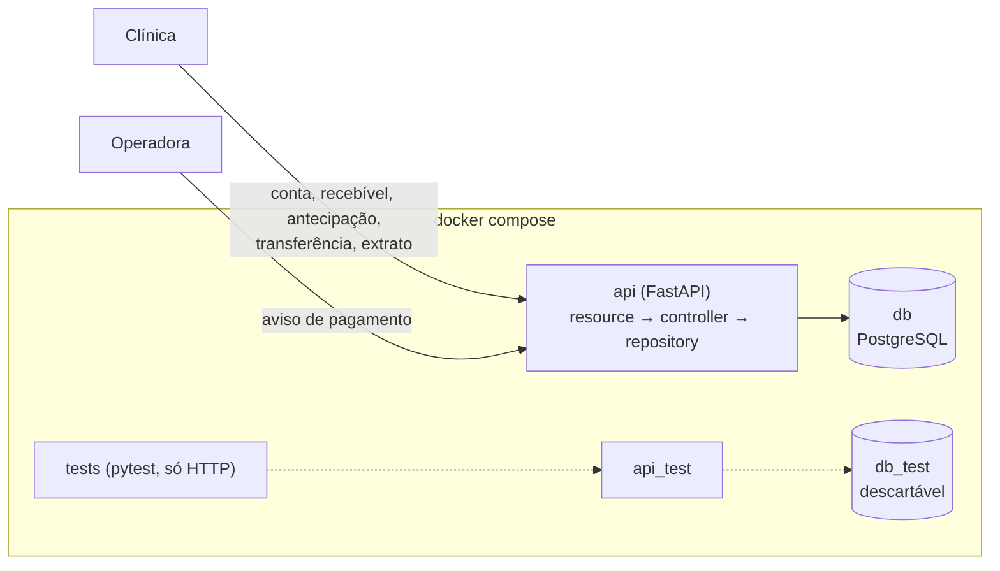
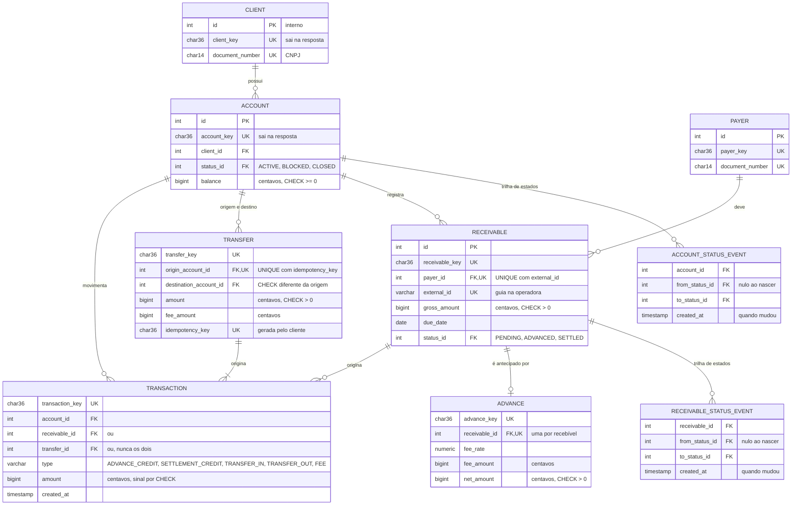

# RFC — Antecipa Saúde: conta e antecipação de recebíveis de convênio, com cada crédito pago uma única vez e saldo que o extrato explica

| | |
|---|---|
| **Time** | \<nome 1\> · \<nome 2\> · \<nome 3\> |
| **Data** | 08/10/2026 |
| **Versão** | 2 |
| **Repositório** | github.com/eduardo3071/QI-Tech-Project |

## Contextualização

### Entendendo o problema

Clínicas, consultórios e laboratórios atendem pelo convênio hoje e recebem da operadora meses depois. Em 2024, hospitais privados associados à Anahp relataram R$ 5,8 bi retidos pelas operadoras (15,9% do faturado) e prazo médio de recebimento subindo de 60–70 para 120 dias; a FenaSaúde contesta e fala em 32,8 dias, com dados da ANS. Se até hospital grande sente o prazo, o prestador pequeno, sem escala para negociar nem caixa para meses de capital de giro, sente mais.

O sistema dá à clínica uma conta e a antecipação dos seus recebíveis de convênio: ela registra a guia que a operadora deve, antecipa e recebe o valor menos a tarifa; quando a operadora paga, o ciclo fecha. Com o dinheiro na conta, transfere para outras contas da plataforma, pagando tarifa. Usam o sistema a clínica e a operadora, que avisa o pagamento.

A garantia sobre o dinheiro: **cada guia vira crédito uma única vez** (não se registra duas vezes, não se antecipa duas vezes, o aviso de pagamento repetido não credita de novo), **nenhuma conta fica negativa**, nem com pedidos simultâneos, e **o saldo é sempre igual à soma do extrato**.

**Fora do escopo:** autenticação; saque para fora da plataforma; pagamento parcial e glosa (a liquidação assume o valor cheio); marcação automática de atraso e inadimplência; taxa por risco de cada operadora; registro da cessão em registradora.

### Explicando a solução de forma macro

Uma API REST em camadas (resource → controller → repository → model) sobre PostgreSQL, subindo com `docker compose`. O recebível tem ciclo de vida (`PENDING → ADVANCED → SETTLED`) e a conta também (`ACTIVE ⇄ BLOCKED → CLOSED`), os dois em tabela de enumerador e com uma linha de evento por mudança de estado. A antecipação e a transferência são entidades próprias. O dinheiro vive em dois lugares que andam juntos no mesmo commit: a coluna `balance` (a verdade do agora, com `CHECK balance >= 0`) e a tabela `transaction` (o extrato, uma linha por movimento, com sinal conferido por `CHECK`). Toda operação que move dinheiro trava as linhas que vai alterar antes de ler o estado: recebível e depois conta na antecipação e na liquidação; as duas contas em ordem de `id` na transferência.

O que foi considerado e descartado:

- **Saldo calculado só pela soma das transações** — descartado porque toda checagem de saldo viraria um `SUM` e a transferência não teria uma linha para travar antes de decidir. Ganharia se a disputa pela mesma conta fosse alta a ponto de a trava virar gargalo.
- **Antecipação e transferência como colunas** (no recebível, ou nulas na transação) — descartado porque "uma antecipação por recebível" e "a mesma transferência não repete" virariam `if` no controller. Como tabelas próprias, são `UNIQUE` no banco. Ganharia se elas não tivessem dados próprios.
- **Idempotência da transferência por cabeçalho `Idempotency-Key` com tabela genérica de respostas** — descartado porque guarda resposta de toda rota para proteger uma só. A chave vai no corpo e mora na própria `transfer`, com `UNIQUE (origin_account_id, idempotency_key)`. Ganharia com muitas rotas não idempotentes por natureza.
- **Trava otimista** (coluna de versão e nova tentativa) — descartado porque o conflito vira erro que o cliente precisa repetir. Ganharia com muita leitura e pouca disputa pela mesma linha.

## Implementação

### Rotas

Convenções: recurso no singular, em inglês, identificado pela `_key` (UUID gerado no repository); o `id` nunca sai da API. Valores em centavos. Erro sempre com `title`, `description`, `translation`, `code`. `400` é pedido fora do schema; `404` é a chave do caminho que não existe; `422` é pedido bem formado que a regra recusa (inclusive chave citada no corpo que não existe); `409` é estado que não permite.

| Método | Caminho | O que faz | Entrada (campos que importam) | Saídas (status e quando) |
|---|---|---|---|---|
| `POST` | `/client` | Cadastra a clínica | `document_number` (CNPJ), `legal_name`, `email` | `201`; `409` QIT001002 CNPJ já existe; `400`. Repetir não duplica: `UNIQUE` no CNPJ |
| `POST` | `/client/{client_key}/account` | Abre conta `ACTIVE`, saldo 0 | `client_key` | `201`; `404` QIT001001. Não idempotente: cada chamada abre uma conta |
| `GET` | `/account/{account_key}` | Lê a conta | — | `200`; `404` QIT002001 |
| `PATCH` | `/account/{account_key}` | Muda o estado da conta | `status`, `reason` | `200` (mesmo estado também: idempotente); `409` QIT002004 transição proibida (`CLOSED` é final); `409` QIT002005 encerrar com saldo ou recebível em aberto; `404`; `400` |
| `POST` | `/account/{account_key}/transaction` | Transfere para outra conta; tarifa de R$ 2,00 na origem | `type` = `TRANSFER`, `destination_account_key`, `amount`, `idempotency_key` | `201`; `200` repetição com a mesma chave, sem mover dinheiro; `409` QIT005002 chave reusada com outro valor ou destino; `422` QIT002003 saldo < valor + tarifa; `422` QIT005001 mesma conta; `422` QIT002006 destino não existe; `409` QIT002002 conta não `ACTIVE`; `404` origem; `400` |
| `GET` | `/account/{account_key}/transactions?page=&limit=` | Extrato paginado, mais recente primeiro, com saldo e total | `page` ≥ 1, `limit` 1–100 | `200`; `404`; `400` paginação inválida |
| `POST` | `/payer` | Cadastra a operadora | `document_number`, `legal_name` | `201`; `409` QIT004002; `400` |
| `POST` | `/account/{account_key}/receivable` | Registra recebível em `PENDING` | `payer_key`, `external_id` (guia), `gross_amount`, `due_date` | `201`; `409` QIT003003 guia já registrada para a operadora; `422` QIT004003 operadora não existe; `409` QIT002002 conta não `ACTIVE`; `404` conta; `400`. Repetir sai em `409` pelo `UNIQUE (payer_id, external_id)` |
| `GET` | `/receivable/{receivable_key}` | Lê o recebível | — | `200`; `404` QIT003001 |
| `POST` | `/receivable/{receivable_key}/advance` | Antecipa: credita o bruto, debita a tarifa | — | `201` com `fee_rate`, `fee_amount`, `net_amount`; `409` QIT003002 fora de `PENDING`; `422` QIT003004 vencido; `409` QIT002002 conta não `ACTIVE`; `404`. Repetir nunca credita de novo: sai em `409` |
| `POST` | `/receivable/{receivable_key}/settlement` | Registra o pagamento da operadora | — | `200` em `SETTLED`; `404`. Idempotente: já `SETTLED` devolve `200` sem escrita |

### Banco de Dados (Somente diagrama)

### Fluxos

**Antecipação — caminho feliz** (`POST /receivable/{receivable_key}/advance`)

1. Trava o recebível com `SELECT … FOR UPDATE`; daqui até o commit ninguém mais mexe nele.
2. Com a trava, confere: está em `PENDING` e não venceu.
3. Trava a conta (sempre depois do recebível) e confere que está `ACTIVE`.
4. Calcula: `fee_rate = min(1,5% + 0,05% × dias até o vencimento, 8%)`; tarifa = bruto × taxa, arredondada meio para cima em centavos. R$ 1.000,00 a 30 dias: taxa de 3%, tarifa de R$ 30,00, R$ 970,00 na conta.
5. Grava a antecipação, `ADVANCE_CREDIT` (+bruto), `FEE` (−tarifa), `balance` += líquido, recebível em `ADVANCED` com evento. Um commit; `201`.

**Antecipação — falha: dois pedidos simultâneos para o mesmo recebível**

1. A pega a trava do recebível; B espera no passo 1.
2. A faz commit com o recebível em `ADVANCED`; B é liberado, lê `ADVANCED` e sai com `409` antes de escrever.
3. Se algum caminho escapar da trava, o `UNIQUE` em `advance.receivable_id` recusa a escrita, a transação inteira é desfeita e o cliente recebe `409` QIT000409.

**Transferência — caminho feliz** (`POST /account/{account_key}/transaction`)

1. Resolve origem e destino pelas keys; recusa mesma conta (`422`) e destino inexistente (`422`).
2. Trava as duas contas **em ordem crescente de `id`**, qualquer que seja o sentido: A → B e B → A simultâneas travam na mesma ordem, uma espera a outra e não há impasse.
3. Procura transferência com a mesma `idempotency_key` na origem. Se existir com o mesmo destino e valor, devolve `200` com ela e não move nada.
4. Confere as duas contas `ACTIVE` e saldo da origem ≥ valor + R$ 2,00.
5. Grava `transfer`, `TRANSFER_OUT` (−valor) e `FEE` (−tarifa) na origem, `TRANSFER_IN` (+valor) no destino, atualiza os dois saldos. Um commit; `201`.

**Transferência — falha: saldo que só cobre uma de várias transferências simultâneas**

1. Oito pedidos de R$ 60,00 saem ao mesmo tempo de uma conta com R$ 100,00.
2. Todos disputam a trava da origem; o primeiro debita R$ 62,00 e faz commit.
3. Cada um dos outros, ao pegar a trava, lê o saldo já atualizado (R$ 38,00) e sai com `422` QIT002003 sem escrever nada.

**Liquidação — caminho feliz e repetição** (`POST /receivable/{receivable_key}/settlement`)

1. Trava o recebível. Se já está em `SETTLED`, devolve `200` sem escrita: o aviso repetido da operadora não credita de novo.
2. Se está em `PENDING`, trava a conta, grava `SETTLEMENT_CREDIT` com o bruto e soma ao saldo. Conta `BLOCKED` também recebe: o bloqueio impede tirar dinheiro, não entrar.
3. Se está em `ADVANCED`, não mexe na conta: a clínica já recebeu o líquido e o pagamento remunera a plataforma.
4. Muda para `SETTLED` com evento; commit; `200`. Mesma ordem de trava da antecipação: se as duas chegam juntas, quem vem depois encontra o estado final da outra.

> ## Principal desafio
>
> - **Qual é:** garantir que cada crédito entre uma única vez e que nenhuma conta gaste o que não tem, com pedidos simultâneos e repetidos, mantendo o saldo igual à soma do extrato.
> - **Por que é difícil:** a solução óbvia é ler e depois gravar. Dois pedidos leem o mesmo estado (`PENDING`, ou saldo de R$ 100) antes de qualquer um gravar e os dois passam. Cada operação escreve em três a cinco lugares, e travar várias linhas sem ordem cria impasse.
> - **Como o desenho resolve:** (1) `SELECT … FOR UPDATE` antes de ler estado ou saldo: ler e decidir na mesma transação; (2) ordem fixa de trava: recebível e depois conta; entre contas, menor `id` primeiro; (3) todas as escritas de uma operação num único commit, desfeitas juntas em qualquer erro; (4) repetição tratada como regra: estado final para antecipação e liquidação, `idempotency_key` para transferência, `external_id` para registro de guia; (5) o banco como última barreira: `UNIQUE` em antecipação, guia e chave de idempotência, `CHECK` de saldo não negativo e de sinal por tipo de lançamento. Os testes por HTTP provam com pedidos paralelos: 10 antecipações do mesmo recebível dão um `201`; 8 transferências que o saldo cobre uma vez dão um `201`; 20 cruzadas A ⇄ B terminam sem impasse.
